

  

  

  

**AI student by day, building anime-flavoured web apps and games by night.**

I love turning ideas into single-file HTML pages you can open anywhere: study tools, quiz apps, little games, and pages that show off what I watch and listen to.

- ✦ Currently studying deep learning and building **ECLIPSE: The Last Kingdom**, an anime-style action RPG
- ✦ Anime fan — my whole watch list lives on [Anime Shelf](https://github.com/AnanthKrishnaJ/anime-shelf)
- ✦ Making the **ZXVI OneAI Toolkit**: a pile of offline tools in one HTML file
- ✦ Comfortable in HTML, CSS, JavaScript and Python

  



<b>🫳 Pat her head</b>


<b>🫳 Pat her again</b>


<b>🫳 Just one more…</b>


<b>👉 Poke her cheek</b>


<b>👉 Poke her again</b>


<b>👉 Poke. Her. Again.</b>


<b>🎀 Touch her ribbons</b>


<b>☕ Give her coffee</b>


<b>💬 Compliment her</b>


<b>💬 Say it again</b>


  
  

  


  

  
  
  <a href="https://github.com/AnanthKrishnaJ/deep-learning-lab-viva"></a>
  <a href="https://github.com/AnanthKrishnaJ/eclipse-the-last-kingdom"></a>
  
  
  <a href="https://github.com/AnanthKrishnaJ/eclipse-evolution-wiki"></a>
  <a href="https://github.com/AnanthKrishnaJ/zxvi-oneai-toolkit"></a>
  <a href="https://github.com/AnanthKrishnaJ/Airi"></a>
  <a href="https://github.com/AnanthKrishnaJ/Uma-Sus-Cup-Tracker"></a>
  <a href="https://github.com/AnanthKrishnaJ/myrpggame"></a>
  <a href="https://github.com/AnanthKrishnaJ/useless-evolution1"></a>
  <a href="https://github.com/AnanthKrishnaJ/jigsaw-solver"></a>
  <a href="https://github.com/AnanthKrishnaJ/auto-solver-hextris"></a>
  <a href="https://github.com/AnanthKrishnaJ/solver1"></a>
  <a href="https://github.com/AnanthKrishnaJ/spotimer"></a>
  <a href="https://github.com/AnanthKrishnaJ/LabRoboticsAIT332"></a>
  <a href="https://github.com/AnanthKrishnaJ/ccw-scholar"></a>
  <a href="https://github.com/AnanthKrishnaJ/Mei"></a>
  <a href="https://github.com/AnanthKrishnaJ/MCwebmake"></a>
  <a href="https://github.com/AnanthKrishnaJ/Ananathprofile"></a>
  <a href="https://github.com/AnanthKrishnaJ/Anime-Guessing-Game"></a>


  
  
  
  
  
  
  
  
  

  

  

