

  

  

  


**AI student by day, building anime-flavoured web apps and games by night.**

I love turning ideas into single-file HTML pages you can open anywhere: study tools, quiz apps, little games, and pages that show off what I watch and listen to.

- ✦ Currently studying deep learning and building **ECLIPSE: The Last Kingdom**, an anime-style action RPG
- ✦ Anime fan — my whole watch list lives on [Anime Shelf](https://github.com/AnanthKrishnaJ/anime-shelf)
- ✦ Making the **ZXVI OneAI Toolkit**: a pile of offline tools in one HTML file
- ✦ Comfortable in HTML, CSS, JavaScript and Python

  

  
  

  

  


  
  
  <a href="https://github.com/AnanthKrishnaJ/WTalk"></a>
  <a href="https://github.com/AnanthKrishnaJ/anime-shelf"></a>
  
  
  <a href="https://github.com/AnanthKrishnaJ/s7-ai-pyq-bank"></a>
  <a href="https://github.com/AnanthKrishnaJ/RPS"></a>


  

  

