  

  

  

### Hey there, I'm Ananth

**AI student by day, building anime-flavoured web apps and games by night.**

I love turning ideas into single-file HTML pages you can open anywhere: study tools, quiz apps, little games, and pages that show off what I watch and listen to.

- ✦ Currently studying deep learning and building **ECLIPSE: The Last Kingdom**, an anime-style action RPG
- ✦ Anime fan — my whole watch list lives on [Anime Shelf](https://github.com/AnanthKrishnaJ/anime-shelf)
- ✦ Making the **ZXVI OneAI Toolkit**: a pile of offline tools in one HTML file
- ✦ Comfortable in HTML, CSS, JavaScript and Python

  
  

  

### ✦ Tools I reach for

  

### ✦ Things I've built

  
  
  
  
  
  
  
  

### ✦ Contribution snake

  <picture>
    <source media="(prefers-color-scheme: dark)" srcset="https://raw.githubusercontent.com/AnanthKrishnaJ/AnanthKrishnaJ/output/github-snake-dark.svg" />
    <source media="(prefers-color-scheme: light)" srcset="https://raw.githubusercontent.com/AnanthKrishnaJ/AnanthKrishnaJ/output/github-snake.svg" />
    
  </picture>

  

